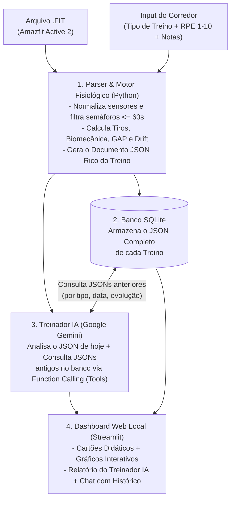

# Running Metrics Analyzer — Amazfit Active 2 (Plano do Projeto)

Sistema pessoal de análise fisiológica, biomecânica e evolução de corridas a partir de arquivos `.FIT` exportados do **Amazfit Active 2** (via app Zepp), combinando processamento determinístico de dados em Python com um **Treinador IA (Google Gemini)** capaz de consultar diretamente os JSONs completos do seu histórico de treinos para tirar conclusões profundas sobre a sua evolução.

---

## 1. Contexto do Corredor e Rotina de Treinos

- **Experiência**: 2 meses de corrida.
- **Rotina Semanal (3x por semana — Seg / Qua / Sex)**:
  - **Segunda-feira**: Rodagem leve (5 km) **ou** Treino mais longo (10 a 15 km).
  - **Quarta-feira**: Treino de qualidade / forte (**Intervalados / Tiros** ou **Fartlek**).
  - **Sexta-feira**: Complemento da segunda-feira (se fez longo na segunda, faz 5 km leve na sexta; se fez 5 km na segunda, faz o longo na sexta).
- **Principal dor atual**: Ao abrir o aplicativo Zepp, apenas métricas básicas como *Pace*, *Tempo*, *BPM* e gráficos simples fazem sentido. Todas as outras dezenas de métricas fisiológicas e biomecânicas ficam subutilizadas por falta de tradução prática (*"O que esse número significa? Isso foi bom ou ruim para o treino de hoje?"*).

---

## 2. Descobertas Reais nos seus Arquivos `.FIT` (`fit-archive-example/`)

Inspecionamos os 3 arquivos reais colocados na pasta [`fit-archive-example/`](file:///home/jvnasc/USP/projetos/metrics-analyzer/fit-archive-example) ([`5km.fit`](file:///home/jvnasc/USP/projetos/metrics-analyzer/fit-archive-example/5km.fit), [`10km.fit`](file:///home/jvnasc/USP/projetos/metrics-analyzer/fit-archive-example/10km.fit) e [`Intervalado.fit`](file:///home/jvnasc/USP/projetos/metrics-analyzer/fit-archive-example/Intervalado.fit)).

### 2.1 Resumo Comparativo dos 3 Treinos Analisados

| Métrica Extraída do `.FIT` | `5km.fit` | `10km.fit` | `Intervalado.fit` |
| :--- | :--- | :--- | :--- |
| **Distância Total** | 5,01 km | 10,01 km | 4,88 km |
| **Tempo em Movimento (`timer_time`)** | 26m 32s | 1h 08m 32s | 23m 32s |
| **Tempo Total Decorrido (`elapsed_time`)** | 32m 21s | 1h 32m 07s | 32m 29s |
| **Pace Médio (em movimento)** | **5:18 /km** | **6:51 /km** | **4:49 /km** |
| **FC Média / Máxima** | 170 bpm / 192 bpm | 156 bpm / 183 bpm | 180 bpm / 195 bpm |
| **Potência Média / Máxima** | 240 W / 332 W | 196 W / 291 W | 252 W / 315 W |
| **Cadência Média** | ~168 spm (84 rpm × 2) | ~158 spm (79 rpm × 2) | ~170 spm (85 rpm × 2) |
| **Comprimento Médio da Passada** | 1,12 m (1118 mm) | 0,90 m (903 mm) | 1,24 m (1236 mm) |
| **Oscilação Vertical Média** | 7,5 cm (74,6 mm) | 7,2 cm (72,0 mm) | 7,5 cm (74,5 mm) |
| **Razão Vertical (*Vertical Ratio*)** | 6,7 % | 8,0 % | 6,1 % |
| **Tempo de Contato com o Solo (*Stance Time*)** | 262 ms | 294 ms | 263 ms |
| **Ganho / Perda de Elevação** | +7 m / -8 m (Plano) | +107 m / -111 m (Subidas) | +3 m / 0 m (Plano) |
| **Training Effect (Aeróbico / Anaeróbico)** | 3.4 / 1.9 | 3.3 / 0.2 | 3.9 / 3.1 |

---

### 2.2 Solução para o Problema das Pausas (Semáforo vs. Descanso Real)

Ao extrair os eventos de `timer stop/start` (quando o relógio é pausado e despausado) nos 3 arquivos, validamos exatamente a sua regra de **60 segundos**:

- **`10km.fit` (20 pausas no total = 23m28s parado)**:
  - **Pausas $\le$ 60s (Semáforo / Trânsito)**: Foram **12 pausas** rápidas (`[5s, 12s, 10s, 5s, 3s, 43s, 6s, 22s, 57s, 35s, 39s, 37s]`), somando apenas **4m 34s** no total!
  - **Pausas $>$ 60s (Descanso / Hidratação / Parada longa)**: Foram **8 pausas** (`[73s, 100s, 157s, 98s, 64s, 99s, 86s, 457s]`), somando **18m 54s** (incluindo uma parada de ~7m37s na reta final).
- **`5km.fit` (2 pausas no total)**:
  - **Pausas $\le$ 60s**: **0 pausas**.
  - **Pausas $>$ 60s**: **2 pausas** de descanso (`[181s, 167s]` — ~3 minutos cada).
- **`Intervalado.fit` (4 pausas no total)**:
  - **Pausas $\le$ 60s**: **1 micro-pausa** de `1s` logo ao dar a largada (ajuste de botão).
  - **Pausas $>$ 60s (Recuperação entre tiros)**: **3 pausas cirúrgicas** de `[179s, 178s, 178s]` (exatos 3 minutos de descanso entre os 4 tiros!).

#### Regras do Filtro Inteligente de Pausas no Sistema:
1. **Micro-pausas / Semáforo ($\le$ 60 segundos)**:
   - Classificadas automaticamente como **Interrupções Urbanas (Semáforo/Trânsito)**.
   - **Não quebram os blocos de corrida** e não contam como descanso fisiológico.
   - **Limpeza de Ruído de GPS Pós-Semáforo**: Quando você para no sinal e volta a correr, o GPS do relógio leva de 5 a 8 segundos para perceber que você acelerou (registrando velocidades artificialmente baixas nesses primeiros segundos). O sistema vai suavizar/descartar essa janela de retomada pós-semáforo para não sujar seu cálculo de consistência de Pace e Cadência.
2. **Pausas de Descanso / Recuperação ($>$ 60 segundos)**:
   - Em treinos **Intervalados**, o sistema usa essas pausas $> 60\text{s}$ para **fatiar automaticamente os Tiros**, ignorando a divisão cega de 1 km do relógio e mostrando: *Tiro 1 (1,22 km @ 4:45/km) → Descanso (3:00) → Tiro 2...*
   - Em treinos **Contínuos (5 km / 10 km)**, o sistema contabiliza separadamente o tempo parado em descansos $> 60\text{s}$ e mede a **Recuperação de Frequência Cardíaca (HRR)**: quantos batimentos seu coração conseguiu baixar durante a parada.

---

## 3. Fluxo de Uso no Dia a Dia

Quando você abrir o sistema no navegador e subir um arquivo `.FIT`:

1. **Detecção Inteligente + Confirmação do Tipo de Treino**:
   - O sistema lê os dados (distância, variações de velocidade e pausas $> 60\text{s}$) e já **sugere automaticamente** qual foi o treino da sua rotina:
     - *Rodagem Leve (5 km)*
     - *Treino Longo (10–15 km)*
     - *Intervalado / Tiros (Quarta Forte)*
     - *Fartlek (Quarta Forte sem pausar o relógio)*
     - *Teste / Prova*
   - Você pode apenas confirmar ou trocar com 1 clique. Assim a IA avalia o treino pelo **objetivo real dele** (ex: FC alta na quarta-feira de tiros é elogiada; FC alta na rodagem leve de segunda/sexta gera um alerta amigável para correr mais devagar).
2. **Contexto Pessoal do Dia (Opcional)**:
   - Uma barra de **Sensação de Esforço (RPE de 1 a 10)** e um campo de texto livre para você anotar coisas que o relógio não sabe: *"Estava 32°C e sol forte"*, *"Dormi só 5h"*, *"Corri conversando com meu amigo"*, *"Senti a panturrilha pesar no km 7"*.
3. **Painel Visual + Relatório do Treinador IA + Chat**:
   - Cartões com suas métricas traduzidas (com selos visuais: **Ótimo**, **Normal**, **Atenção**).
   - Gráficos interativos limpos (com as pausas de semáforo $\le 60\text{s}$ filtradas e subidas destacadas).
   - Relatório completo do Gemini + **Chat aberto** onde a IA pode consultar qualquer treino passado no banco para responder dúvidas suas.

---

## 4. Como Funciona o Armazenamento JSON e a Consulta da IA

Em vez de o Python entregar apenas "médias frias" dos treinos anteriores para a IA, **cada treino processado será salvo no banco SQLite como um Documento JSON Rico e Estruturado** (~600 a 800 tokens por treino).

### 4.1 O que vai dentro do JSON salvo no Banco para cada treino?
> 📄 **Especificação completa e exemplo real:** consulte [`docs/JSON_SCHEMA.md`](file:///home/jvnasc/USP/projetos/metrics-analyzer/docs/JSON_SCHEMA.md).

O Python faz a matemática pesada em cima dos ~4.000 segundos do arquivo `.FIT` (para a IA não errar contas) e gera um JSON limpo contendo:
- **Metadados e Contexto do Usuário**: Data, dia da semana, tipo de treino (`Rodagem Leve`, `Longo`, `Intervalado`, `Fartlek`), nota de esforço percebido (`RPE 1-10`) e suas anotações em texto livre.
- **Métricas Globais e Fisiológicas**: Distância, tempo ativo, pace médio, FC média/máxima, tempo em cada Zona de FC (Z1 a Z5), Training Effect (Aeróbico/Anaeróbico), Deriva Cardíaca (*Cardiac Drift* em %) e Potência média/máxima (W).
- **Métricas Biomecânicas (*Running Dynamics*)**: Cadência média/máx (spm), comprimento médio de passada (m), oscilação vertical (cm), razão vertical (%) e tempo de contato com o solo (ms).
- **Análise de Pausas**: Quantidade e tempo total em semáforos ($\le 60\text{s}$) vs. lista detalhada de pausas de descanso ($> 60\text{s}$) com a queda de FC em cada parada.
- **Lista de Parciais por Km (`laps`)**: Pace, FC média/máx, cadência, potência e ganho/perda de elevação do Km 1 ao Km N.
- **Lista de Blocos / Tiros Reais (`intervals`)**: Quando houver pausas $> 60\text{s}$ ou variações de Fartlek, os dados exatos de cada tiro separado.

### 4.2 Como a IA Consulta esses JSONs no Banco? (Abordagem Híbrida)
Usaremos o recurso de **Tools / Function Calling** do Google Gemini combinado com contexto direto:
1. **Na geração automática do Relatório do Treino**:
   - A IA recebe o **JSON completo do treino de hoje** e tem acesso a **Ferramentas de Consulta (`Tools`)** no banco SQLite:
     - `buscar_ultimos_treinos(limite=10)`: Traz os JSONs completos das suas últimas corridas para ela enxergar sua carga da semana (Seg/Qua/Sex).
     - `buscar_treinos_mesmo_tipo(tipo_treino, limite=5)`: Ex: se hoje é um `Intervalado`, ela busca os JSONs completos dos últimos 5 `Intervalados` para comparar tiro a tiro, cadência, FC e até ler o que você anotou de sensação nas semanas anteriores!
     - `buscar_melhores_marcas()`: Consulta seus melhores paces e menores FCs para a mesma distância.
2. **Por que isso é muito superior?**
   - Porque a própria IA consegue cruzar detalhes finos entre os JSONs: *"Comparando o seu Longo de 10km de hoje com o de duas sextas-feiras atrás: no km 4 (onde tem aquela subida de 30m), sua FC bateu 173 bpm da outra vez e você precisou parar 2 minutos depois; hoje você subiu a mesma ladeira a 162 bpm e seguiu direto sem parar!"*
   - E tudo isso ocupando menos de 5.000 a 10.000 tokens por análise, mantendo custo **zero** dentro da camada gratuita do Gemini!

---

## 5. O Que o Sistema Vai Explicar (Tradutor de Métricas + IA)

| Métrica no Arquivo `.FIT` | O que você vê hoje | Como o nosso sistema vai te explicar na prática |
| :--- | :--- | :--- |
| **Cadência (SPM) + Passada (m)** | Números soltos no app | Explica se você está dando passadas longas demais e lentas (*overstriding*, que freia o movimento e força o joelho) ou passos rápidos e leves. |
| **Oscilação Vertical (cm) + Razão Vertical (%)** | Quase ninguém olha | Mostra "quanto da sua energia está indo para frente vs. pulando para cima". Ex: nos seus 10km foi 8,0% e no Intervalado caiu para 6,1% (excelente!). |
| **Tempo de Contato com o Solo (ms)** | Desconhecido | Tempo que seu tênis fica colado no asfalto a cada passo. Quanto menor (< 270ms), mais elástica e reativa está sua passada. |
| **Potência (Watts) + Altimetria** | Gráfico confuso | Explica por que seu Pace caiu e seu BPM subiu: *"No km 3 dos 10km seu pace caiu para 7:05/km, mas você subiu 20 metros de ladeira mantendo 210W de potência — o esforço foi constante!"* |
| **Training Effect (Aeróbico vs. Anaeróbico)** | Notas de 0.0 a 5.0 | Explica qual sistema do seu corpo trabalhou: o `10km.fit` deu **3.3 Aeróbico / 0.2 Anaeróbico** (construção pura de fôlego/base), enquanto o `Intervalado.fit` deu **3.9 Aeróbico / 3.1 Anaeróbico** (estímulo forte de velocidade e tolerância ao lactato). |
| **Deriva Cardíaca (*Cardiac Drift*)** | Não existe no Zepp | Calculado pelo nosso Python: mostra se o seu coração foi se esgotando na segunda metade do treino ou se aguentou firme no mesmo ritmo. |

---

## 6. Arquitetura Atualizada do Sistema



---

## 7. Estrutura de Pastas do Projeto

```text
metrics-analyzer/
├── PLAN.md                    # Este documento vivo com o plano e descobertas do projeto
├── fit-archive-example/       # Seus arquivos .FIT reais de exemplo (5km, 10km, Intervalado)
├── docs/                      # Documentação complementar (regras fisiológicas, prompts)
├── data/                      # Onde ficará o banco SQLite local (runs.db com os JSONs)
└── src/                       # Código-fonte (quando iniciarmos a implementação)
```
